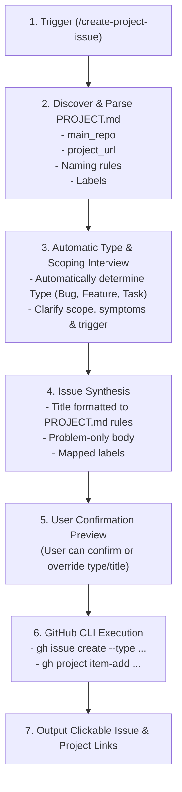

# Create Project Issue Workflow

An interactive pipeline that creates a GitHub issue in a project's designated main repository, automatically determines and assigns its native issue type (`Bug`, `Feature`, or `Task`), links it to a GitHub Project (v2) board, and strictly formats the title and labels based on the repository's `PROJECT.md`.

---

## Core Principles

1. **`PROJECT.md` as Single Source of Truth**:
   - The repository's `PROJECT.md` file defines the target `main_repo`, the `project_url`, the naming conventions/rules, and the label taxonomy.
   - The naming format is **never hardcoded** in the skill; it must be parsed and adapted directly from the rules and examples documented in `PROJECT.md`.
2. **Automatic Issue Type Determination & Native Types**:
   - The agent **automatically infers** the issue type (`Bug`, `Feature`, or `Task`) by analyzing the context, symptoms, or user description. Do not burden the user with selecting the type upfront.
   - The issue type is assigned using GitHub's native issue type flag:
     `gh issue create --type <Type>`.
3. **Interactive Scoping Interview**:
   - The agent actively asks questions (using `ask_question` or interactive chat prompts) to accurately determine the problem scope, affected components, reproduction trigger, and impact before drafting.
4. **Problem-Only Issue Body**:
   - The issue body must **strictly describe the problem only**.
   - **DO NOT** include solution proposals, implementation plans, code snippets proposing fixes, or acceptance criteria. Focus entirely on the defect, gap, symptoms, trigger conditions, and impact.
5. **Interactive Confirmation Guard**:
   - Always present a complete preview card (Target Repo, Project URL, Inferred Issue Type, Suggested Title, Labels, and Body) and obtain user confirmation before executing any GitHub write actions.

---

## Execution Pipeline



---

## Phase 1: Discover & Parse `PROJECT.md`

1. **Locate `PROJECT.md`**:
   - Check the repository root for `PROJECT.md`.
   - If not found, check `.github/PROJECT.md` or the active repository root when working in a multi-repo workspace.
   - If no `PROJECT.md` exists, stop and inform the user:
     > `PROJECT.md` was not found. Please provide a `PROJECT.md` in the repository root specifying the `main_repo`, `project_url`, naming rules, and labels. (See template in `skills/create-project-issue/examples/PROJECT.template.md`).

2. **Extract Configuration**:
   - **`main_repo`**: The target GitHub repository (e.g., `owner/repo-name`).
   - **`project_url`**: The GitHub Project URL (e.g., `https://github.com/orgs/<owner>/projects/<number>` or `https://github.com/users/<owner>/projects/<number>`).
     - Parse `<owner>` and `<number>` from the URL.
   - **Naming Rules**: Extract the title pattern, casing rules, prefixes, and examples defined under the Naming Rules section or frontmatter.
   - **Labels**: Extract allowed labels (e.g., components, categories, priorities).

---

## Phase 2: Automatic Type Inference & Scoping Interview

### 1. Automatic Issue Type Determination
Do **NOT** prompt the user to manually select an issue type. Automatically classify the issue into one of the three native types based on context, error logs, and user reports:
- **`Bug`**: Defects, crashes, regressions, runtime exceptions, unexpected behaviors, incorrect calculations, or broken workflows.
- **`Feature`**: New capabilities, feature requests, enhancements, or missing user-facing functionality.
- **`Task`**: Maintenance, refactoring, dependency upgrades, CI/CD, documentation, test coverage additions, technical debt, or internal chores.

*(Note: The inferred type is surfaced in the Phase 4 preview table, allowing the user to easily override it if they wish).*

### 2. Interactive Scoping Discovery
Actively ask targeted scoping questions (via `ask_question` or chat prompts) to determine the problem boundaries:
- **Observed Problem / Symptom**: What is failing, behaving unexpectedly, or missing?
- **Affected Area / Component**: Which module, UI view, service, or workflow is involved?
- **Trigger Conditions**: Under what circumstances, inputs, or environment does this manifest?
- **Impact / Severity**: Who or what is blocked or degraded by this issue?

---

## Phase 3: Synthesize Issue Content

### 1. Title Generation
- Formulate the title **strictly following the naming rules from `PROJECT.md`**.
- Adhere to the casing, prefixing, brackets, and scope boundaries exemplified in `PROJECT.md`.
- Ensure the title concisely summarizes the **problem** (e.g., `[Bug] auth: session token not refreshed on 401 response`).

### 2. Body Generation (Problem-Only Constraint)
The body must be written to describe the problem and context without prescribing solutions:

```markdown
## Problem Summary
<Concise overview of the issue or missing functionality>

## Observed Behavior & Impact
- **Current Behavior**: <What actually occurs>
- **Operational Impact**: <Who or what is affected, severity or frequency>

## Reproduction / Trigger Conditions
- <Specific steps, inputs, or system states that trigger the problem>

## Context & References
- **Affected Components / Files**: `<path/to/component>`
- **Environment / Logs**: (if applicable)
```

> [!WARNING]
> **Strict Content Boundary**: Do **NOT** include "Proposed Solution", "Implementation Plan", "Acceptance Criteria", or suggested code diffs in the issue body.

### 3. Label Selection
- Select matching labels defined in `PROJECT.md` (e.g., component labels like `auth`, `ui`, `backend` or priority labels if applicable).

---

## Phase 4: Preview & User Confirmation

Present a structured preview for user review:

```markdown
### 📋 Proposed GitHub Issue Preview

| Field | Value |
| :--- | :--- |
| **Main Repository** | `owner/repo` |
| **GitHub Project** | `https://github.com/.../projects/N` |
| **Type** | `Bug` / `Feature` / `Task` |
| **Title** | `<Title following PROJECT.md naming rule>` |
| **Labels** | `label-1`, `label-2` |

<details>
<summary><b>View Issue Body</b></summary>

(Render the synthesized problem-only body here)

</details>

*Would you like to file this issue, or make any adjustments to the title, scope, or labels?*
```

Obtain explicit confirmation from the user before executing Phase 5.

---

## Phase 5: GitHub Issue Creation & Project Linking

Once confirmed, execute the creation via the GitHub CLI:

1. **Write Body to Temporary File**:
   To prevent PowerShell quoting, newline, or escaping issues on Windows, write the body to a temporary file (e.g. `$env:TEMP\issue-body-<timestamp>.md` or in the scratch directory).

2. **Create the GitHub Issue**:
   Run the `gh issue create` command with `--type`:
   ```powershell
   gh issue create --repo "<main_repo>" --title "<title>" --body-file "<temp_body_path>" --type "<Type>" --label "<comma_separated_labels>"
   ```
   *Note: If the repository does not have native GitHub issue types enabled, retry without `--type` and ensure the type label is included.*

3. **Capture Issue URL**:
   The output of `gh issue create` returns the full issue URL:
   `https://github.com/<owner>/<repo>/issues/<issue_number>`

4. **Add to GitHub Project**:
   Run `gh project item-add`:
   ```powershell
   gh project item-add <project_number> --owner "<project_owner>" --url "<issue_url>"
   ```
   *Note on Permissions: If this fails with an authorization error, notify the user to run `gh auth refresh -s project` to grant project write scopes.*

5. **Clean Up**:
   Remove the temporary body file.

6. **Present Results**:
   Provide the user with clickable links:
   - 🎯 **Issue**: `[#<issue_number> - <title>](<issue_url>)`
   - 📌 **Project Board**: `[Project #<project_number>](<project_url>)`
