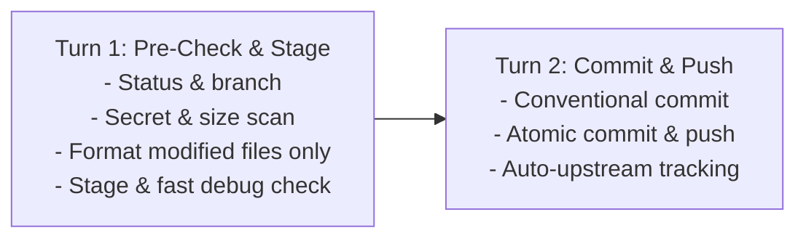

# Git Commit & Push Workflow

A 2-phase high-speed pipeline for safely formatting changed files, staging surgically, committing with conventional messages, and pushing without tool roundtrip latency.

> [!NOTE]
> **Branch Confirmation**: Handled by the **Pre-Modification & Commit Branch Confirmation Guard** in `GEMINI.md`. If the active branch has not yet been confirmed in this conversation (e.g. committing pre-existing changes), ensure the user confirms the branch once before staging and committing.

---

## High-Speed 2-Phase Execution Protocol

To minimize tool latency and eliminate sequential roundtrips, execute this workflow in strictly **two batched turns**:



---

## Phase 1: Pre-Check, Targeted Formatting & Surgical Staging (Turn 1)

Execute the pre-flight inspection and staging in **one single compound command**:

### 1. Compound Inspection
Run status, branch detection, and diff summary together:
- **PowerShell**: `git status -s; git rev-parse --abbrev-ref HEAD; git diff --stat`
- **Bash / POSIX**: `git status -s && git rev-parse --abbrev-ref HEAD && git diff --stat`

### 2. Fast Safety & Leak Checks (Zero Extra Turns)
Directly evaluate the `git status -s` output:
- **Secret Files**: If any untracked or modified file matches sensitive patterns (`.env*`, `*.pem`, `*.key`, `*.pkcs12`, `*.pfx`, `id_rsa`, `id_ed25519`, `credentials.json`, `service-account*.json`, `token.txt`, `.npmrc`, `.pypirc`), **ABORT** immediately and alert the user to add it to `.gitignore`.
- **Large Files (> 5MB)**: If any modified/untracked file exceeds 5MB or contains untracked model/data weights (`.bin`, `.onnx`, `.tar.gz`, `.iso`, `.sqlite`), warn the user and check for Git LFS before staging.

### 3. Targeted Formatting (Changed Files Only — NO Whole-Repo Scans)
Do **NOT** run whole-repository formatters (e.g. `npm run format`, `black .`, `cargo fmt`). Format **only the specific modified files**:
- **Node / TS / JS**: If prettier is available: `npx prettier --write <modified_files>`
- **Python**: If ruff/black is available: `ruff format <modified_files>` or `black <modified_files>`
- **Go**: `gofmt -w <modified_files>`
- **Rust**: `rustfmt <modified_files>`
- **No formatter configured**: Skip immediately to staging.
- **ERROR GATE**: If the formatter exits with a non-zero exit code, **STOP IMMEDIATELY**, show the error, and do not stage or commit.
- **NO TESTS**: Never run test suites (`npm test`, `pytest`, `cargo test`) before push unless explicitly requested.

### 4. Surgical Staging & Native Fast Debug Grep
- Stage only the relevant modified files (strictly avoid blind `git add .`):
  ```bash
  git add path/to/file1.ts path/to/file2.ts
  ```
- **Fast Debug Statement Check (Native Git Grep)**:
  Run native regex scan on staged content without dumping diff text into context:
  ```bash
  git diff --cached -G"(console\.log|debugger|print\(|dump\()" --name-only
  ```
  - If output is empty, proceed immediately to Phase 2.
  - If matches are found, verify whether they are intentional or leftover debug code before committing.
- Confirm staged diff stat: `git diff --cached --stat`

---

## Phase 2: Atomic Commit & Upstream-Aware Push (Turn 2)

### 1. Conventional Commit Message Synthesis
From the staged diff stat, synthesize a Conventional Commit message:
```text
<type>(<optional-scope>): <imperative summary under 72 chars>

[optional bullet points explaining WHY and WHAT changed]
```
Allowed types: `feat`, `fix`, `refactor`, `perf`, `docs`, `style`, `test`, `chore`, `ci`.

### 2. Atomic Commit & Push Execution
Execute commit and push in **one single atomic compound execution** with automatic upstream fallback:
- **PowerShell**:
  ```powershell
  git commit -m "<message>"; if ($LASTEXITCODE -eq 0) { git push; if ($LASTEXITCODE -ne 0) { git push -u origin (git rev-parse --abbrev-ref HEAD) } }
  ```
- **Bash / POSIX**:
  ```bash
  git commit -m "<message>" && (git push || git push -u origin $(git rev-parse --abbrev-ref HEAD))
  ```

### 3. STRICT Divergence & Safety Guards
- **STRICT: NEVER FORCE PUSH** (`--force`, `-f`, or `--force-with-lease`).
- If push is rejected due to remote divergence (non-fast-forward):
  - **STOP IMMEDIATELY**.
  - Advise the user to pull and rebase cleanly: `git pull --rebase origin <branch>`.

### 4. Completion Output
Output a concise 3-line summary:
- **Commit**: `<hash>` — `<message title>`
- **Branch**: `<branch>` (pushed to remote)
- **Files**: List of committed files
